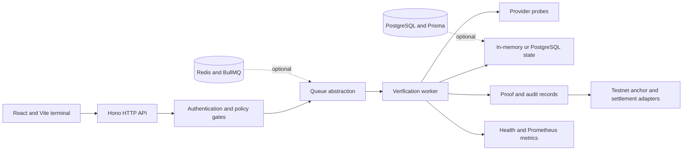

# Tokenta Cleanverse Architecture

This document maps the implemented runtime boundaries in this repository. Tokenta Cleanverse is a public engineering prototype with testnet integrations and production-oriented controls; it is not presented as evidence of a production cloud deployment.

## System Context



The terminal UI calls the backend through `/api/v1`. The backend validates the request, applies buyer and seller policy, records a verification job, and passes it to the configured queue. A worker runs provider probes, derives a terminal result, records proof and audit data, and makes the result available to settlement and monitoring paths.

## Runtime Boundaries

| Boundary | Implementation | Evidence |
| --- | --- | --- |
| HTTP API | Hono application and terminal/verification routes | `server/src/api/`, `server/src/index.ts` |
| Verification engine | Provider routing, probes, scoring, budgets, locks, and orchestration | `server/src/verification/` |
| Async execution | In-process queue by default; Redis list or BullMQ when enabled | `server/src/jobs/queue.ts`, `server/src/jobs/redis-queue.ts`, `server/src/jobs/bull-queue.ts` |
| Persistence | In-memory defaults with opt-in Prisma/PostgreSQL repositories and migrations | `server/src/db/`, `server/prisma/` |
| Credential handling | Fingerprints, encrypted development vault, envelope and HashiCorp adapters, worker key zeroization | `server/src/security/`, `server/src/jobs/worker-zeroize.test.ts` |
| Settlement | Escrow signatures, receipt verification, proof anchoring, and testnet transaction adapters | `server/src/orders/`, `server/src/terminal/`, `server/src/verification/proof-anchor.ts` |
| Observability | JSON health, Prometheus exposition, queue statistics, worker heartbeats, and Grafana dashboard definition | `server/src/metrics/`, `docs/monitoring/grafana-verification-slo.json` |
| Contracts | Generated OpenAPI documents for verification and terminal routes | `swagger/public/openapi/` |

## Verification Flow

1. The API maps and validates the provider request.
2. Abuse limits and buyer/seller credential policy run before a job is accepted.
3. The job is written to the configured store and enqueued through the queue abstraction.
4. The worker resolves the provider adapter and runs the verification orchestrator.
5. The engine applies probe budgets, lock-state transitions, and terminal scoring.
6. The worker clears raw API-key material after success or failure.
7. The result is recorded as verification and audit evidence; optional proof anchoring and monitoring follow.

The default development path uses mock provider responses and in-memory state. PostgreSQL, Redis, BullMQ, live provider calls, and testnet broadcasts are activated explicitly through environment flags.

## Failure and Degraded Modes

- Provider errors are normalized before they reach terminal state handling.
- Verification lock transitions are tested as a finite-state contract.
- Buyer-triggered verification cannot silently consume seller credentials without consent.
- Queue implementations are selected behind a shared interface; Redis and BullMQ are optional rather than required for local development.
- Settlement defaults to dry-run configuration. On-chain fund verification and signing require explicit environment configuration.
- The live OpenAI test is optional and conditionally runs only when the repository secret exists. Required CI remains credential-free.

## Security Boundaries

- Browser code receives public configuration only. Provider and settlement secrets stay in the server process.
- Mutating routes can require API bearer authentication, wallet identity, Privy JWT verification, and request signatures.
- Stored development credentials can be encrypted with AES-256-GCM; production-oriented vault adapters are isolated behind interfaces.
- Escrow and bind operations have signature-verification paths.
- Tests cover credential zeroization, encrypted vault behavior, JWT/JWKS handling, signature validation, and audit records.

See [SECURITY.md](./SECURITY.md) for responsible disclosure and [server/.env.example](./server/.env.example) for the complete configuration surface.

## Observability

- `GET /api/v1/metrics/health` returns application health and verification composition data.
- `GET /metrics/prometheus` exposes verification, duration, queue, and BullMQ metrics.
- Worker topology and heartbeat endpoints expose configured worker state.
- `docs/monitoring/grafana-verification-slo.json` is an importable dashboard definition; it does not represent hosted production telemetry by itself.

## Test Strategy

The credential-free suite includes unit tests, route-level integration tests, a verification end-to-end slice, and isolated security and settlement contracts. CI adds PostgreSQL migration and persistence smoke tests plus a Redis/BullMQ enqueue smoke test. Live-provider behavior is separated into an optional secret-backed job.

Run the same core contracts locally:

```bash
npm ci
npm run build
npm ci --prefix server
npm run db:generate --prefix server
npm test --prefix server
npm run test:e2e --prefix server
```

## Known Limits

- Local development is in-memory unless persistence flags are enabled.
- The Compose stack is a development topology, not a cloud deployment definition.
- Regional queue names and worker topology are implementation scaffolding; this repository does not claim a deployed multi-region service.
- Proof anchoring and settlement modules target testnets and include dry-run or mock paths.
- No cloud-provider infrastructure-as-code, cluster deployment, or streaming/RPC platform is implemented in this repository.
